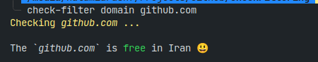
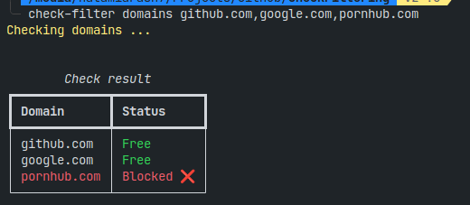
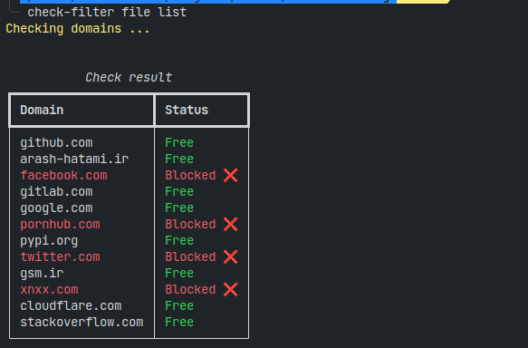

# Check Filtering

[](https://www.python.org/)
[](https://GitHub.com/hatamiarash7/CheckFiltering/releases/)
[](https://github.com/hatamiarash7/CheckFiltering/actions/workflows/release.yml)
[](https://codecov.io/gh/hatamiarash7/CheckFiltering)


[](https://github.com/psf/black)
[](https://github.com/astral-sh/ruff)
[](https://mypy-lang.org/)

A Python CLI and library for detecting DNS-based domain filtering in Iran.

Check Filtering resolves a domain's IPv4 **A records** and compares the returned
addresses with known Iranian ISP blocking IPs. You can check a single domain,
a comma-separated list, or a UTF-8 file, with concurrent DNS queries and a live
Rich results table.

> [!WARNING]
> This is a DNS-blocking heuristic, not an accessibility test. A **Free** result
> only means that no known blocking IP appeared in the A-record response.
> It cannot detect HTTP/TLS filtering, IP blocking, connection interference,
> IPv6-only filtering, or other network failures. Results depend on your network
> and the resolver you query; using a public resolver may bypass ISP DNS filtering.

## Installation

You need **Python 3.10 or newer**.

```bash
python -m pip install check-filter
check-filter --version
```

For an isolated CLI installation, you can use `pipx install check-filter` instead.
Wheels are also available on the [releases page](https://github.com/hatamiarash7/CheckFiltering/releases/latest).

### From source

Install [Poetry](https://python-poetry.org/docs/#installation), then run:

```bash
git clone https://github.com/hatamiarash7/CheckFiltering.git
cd CheckFiltering
poetry install --only main
poetry run check-filter --help
```

## CLI usage

Pass domain names, not URLs, IP addresses, paths, or port numbers.

```bash
# One domain
check-filter domain github.com

# Multiple domains (quote the argument if it contains spaces)
check-filter domains "github.com, google.com, twitter.com"

# One domain per line
check-filter file domains.txt

# Version and command-specific help
check-filter --version
check-filter domain --help
check-filter domains --help
check-filter file --help
```

Example `domains.txt`:

```text
# Development
github.com
gitlab.com

# Social media
twitter.com
```

Blank lines and full-line comments are ignored, including indented comments.
Whitespace around domains is stripped. UTF-8 files with a byte-order mark and
Windows line endings are supported. Inline comments are not supported.
Invalid domains stop the command before DNS queries begin.

Test a single domain:



Test multiple domains:



Test a file of domains:



### Interpreting results

| Status      | Meaning                                                                                                   |
| ----------- | --------------------------------------------------------------------------------------------------------- |
| **Free**    | At least one A record was returned, with no known blocking IP. This does **not** guarantee accessibility. |
| **Blocked** | At least one returned A record matches a configured blocking IP.                                          |
| **Unknown** | The resolver returned NXDOMAIN or no A record; filtering cannot be determined.                            |
| **Error**   | The DNS query failed, for example due to a timeout or unavailable nameservers.                            |

The CLI displays results in **completion order**. Successful command execution
exits with code `0` even when results are Blocked, Unknown, or Error; it is not a
machine-readable accessibility exit code. Input validation and file-read errors
exit nonzero. Use the library to inspect individual statuses and error details.

## Python library

```python
import asyncio

from check_filter import DomainChecker, FilterStatus


async def main():
    checker = DomainChecker()

    result = await checker.acheck("github.com")
    print(result.domain, result.status.value, sorted(result.ips))

    # Results preserve input order, including duplicate domains.
    results = await checker.acheck_many(["google.com", "twitter.com", "github.com"])
    for result in results:
        if result.status is FilterStatus.BLOCKED:
            print(f"{result.domain}: known blocking IP detected")
        elif result.status is FilterStatus.FREE:
            print(f"{result.domain}: no known DNS blocking IP detected")
        else:
            print(f"{result.domain}: {result.status.value}: {result.error}")


asyncio.run(main())
```

Do not treat `not result.is_blocked` as equivalent to `result.is_free`:
both properties are false for Unknown and Error results. If you already have an
async event loop, await the methods directly instead of calling `asyncio.run()`.

### Resolver configuration

Custom DNS servers, blocking IPs, and query lifetimes are **library options**;
the CLI currently has no flags for them.

```python
from check_filter import DomainChecker

checker = DomainChecker(
    blocked_ips={"10.10.34.34", "10.10.34.35", "10.10.34.36"},
    nameservers=["8.8.8.8", "8.8.4.4"],
    timeout=10.0,
)
```

| Setting       | Default / behavior                                                                                                                                                      |
| ------------- | ----------------------------------------------------------------------------------------------------------------------------------------------------------------------- |
| `blocked_ips` | `10.10.34.34`, `10.10.34.35`, `10.10.34.36`. `None` selects defaults; an empty set disables blocking-IP matches.                                                        |
| `nameservers` | `8.8.8.8`, or `178.22.122.100` when the `CI` environment variable exists, even if its value is `false`. A nonempty list overrides this. An empty list selects defaults. |
| `timeout`     | `5.0` seconds for the DNS query lifetime, including retries. Must be finite and greater than zero.                                                                      |

The resolver is created with `configure=False`: **system DNS settings are not
loaded**. To test a particular ISP's DNS filtering, explicitly supply its resolver
through the library. NXDOMAIN and missing A records are inconclusive and do not
by themselves prove censorship.

### API summary

The package root exports `DomainChecker`, `CheckResult`, and `FilterStatus`.

- `await checker.acheck(domain: str) -> CheckResult`: strips whitespace and
  lowercases the domain. Empty/whitespace-only input raises `dns.resolver.NoAnswer`
  for backward compatibility. DNS failures become Error or Unknown results.
- `await checker.acheck_many(domains: list[str]) -> list[CheckResult]`: runs checks
  concurrently and returns input order. An empty list returns `[]`. On an
  unexpected exception or cancellation, unfinished checks are cancelled and awaited.
- `CheckResult` is a frozen dataclass with `domain: str`, `status: FilterStatus`,
  `ips: frozenset[str]`, and `error: str | None`. It has `is_free` and `is_blocked`
  properties and supports legacy `domain, is_free = result` unpacking.
- `FilterStatus` values are `FREE = "free"`, `BLOCKED = "blocked"`,
  `UNKNOWN = "unknown"`, and `ERROR = "error"`.

Batch queries are concurrent without a fixed concurrency limit. For very large
inputs, submit manageable batches rather than scheduling an entire dataset at once.

## Development

```bash
make install-dev       # Install Poetry dev and test dependency groups
make help              # List all targets
make check-fast        # Format checks, Ruff, Pylint, mypy, and offline tests
make test-cov-fast     # Offline tests with branch coverage and HTML report
```

Poetry keeps the virtual environment in `.venv`. Library code remains compatible
with Python 3.10; CI runs offline tests on Python 3.10–3.14.

| Command             | Purpose                                                   |
| ------------------- | --------------------------------------------------------- |
| `make test-fast`    | Run unit tests without live DNS integration tests.        |
| `make test`         | Run all tests, including live DNS queries.                |
| `make test-cov`     | Run all tests with coverage reports.                      |
| `make format`       | Apply Black and isort formatting.                         |
| `make format-check` | Check formatting without modifying files.                 |
| `make lint`         | Run Ruff and Pylint.                                      |
| `make lint-fix`     | Apply auto-fixable Ruff changes only.                     |
| `make type-check`   | Run mypy.                                                 |
| `make check`        | Run format checks, lint, types, then all tests.           |
| `poetry build`      | Build the wheel and source distribution without cleaning. |
| `make build`        | Clean generated artifacts/caches, then build.             |

Coverage includes branches and enforces an **80% minimum**. The HTML coverage
report is written to `htmlcov/index.html`. Live integration tests require working
external DNS and their results depend on your network; use the `*-fast` targets
for offline or restricted environments.

To run a focused test:

```bash
poetry run pytest tests/test_check.py::TestDomainChecker::test_acheck_free_domain
poetry run pytest tests/test_cli.py -m "not slow and not integration"
```

Optional non-mutating pre-commit checks use your Poetry-managed tools:

```bash
make pre-commit-install
make pre-commit
```

### CI and releases

The Checks workflow runs formatting, lint, typing, and offline coverage checks on
pull requests and pushes to `master`. The Release workflow reuses those checks
and builds distributions once. Publishing a GitHub release requires a tag matching
`v<pyproject.toml version>` and publishes to PyPI using the `PYPI_TOKEN` secret.
Manual workflow dispatch only checks and builds; it does not publish.

Keep `pyproject.toml` and `check_filter/__init__.py` versions aligned; a unit test
enforces this. The `make release-*` helpers change Poetry metadata only, so update
the library version before tagging a release.

## Contributing

Fork the repository, create a branch, and install dependencies with
`make install-dev`. Add regression tests for behavior changes, run
`make check-fast`, and run `make check` when external DNS is available. Submit a
pull request with a description of the change and your verification results.

Found a bug or have a suggestion? [Open an issue](https://github.com/hatamiarash7/CheckFiltering/issues).

## Support

- [Donate Bitcoin](https://donatebadges.ir/donate/Bitcoin/bc1qmmh6vt366yzjt3grjxjjqynrrxs3frun8gnxrz)
- [Donate Ethereum](https://donatebadges.ir/donate/Ethereum/0x0831bD72Ea8904B38Be9D6185Da2f930d6078094)
- [PayPing](https://payping.ir/@hatamiarash7)

## License

MIT — see [LICENSE](LICENSE).
